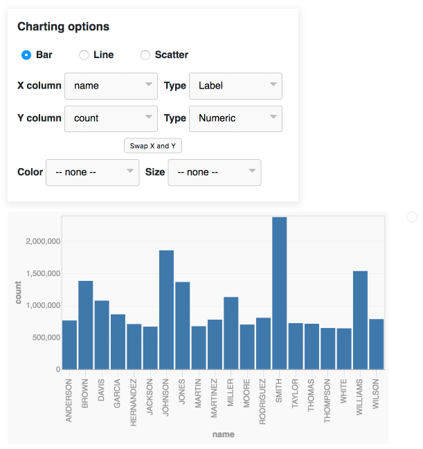

# datasette-vega

A [Datasette](https://github.com/simonw/datasette) plugin that provides tools
for generating charts using [Vega](https://vega.github.io/).

Try out the latest master build as a live demo at https://datasette-vega-latest.datasette.io/ or try the latest release installed as a plugin at https://fivethirtyeight.datasettes.com/

To add this to your Datasette installation, install the plugin like so:

    pip install datasette-vega

The plugin will then add itself to every Datasette table view.

If you are publishing data using the `datasette publish` command, you can
include this plugin like so:

    datasette publish now mydatabase.db --install=datasette-vega

## Development

The JavaScript is bundled using [esbuild](https://esbuild.github.io/). Install the dependencies and build the plugin's static assets into `datasette_vega/static/` like this:

    npm install
    npm run build

This needs to run before building the Python package, since the bundled assets are not checked into the repository.

To work on the charting interface against the demo page in `public/index.html`, with automatic rebuilds:

    npm run dev

Then open `http://localhost:3000/`.

To run the Python tests (after `npm run build`):

    uv run pytest
